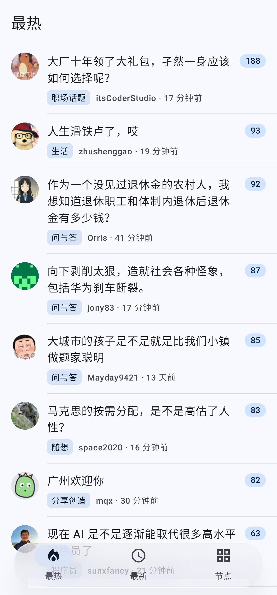
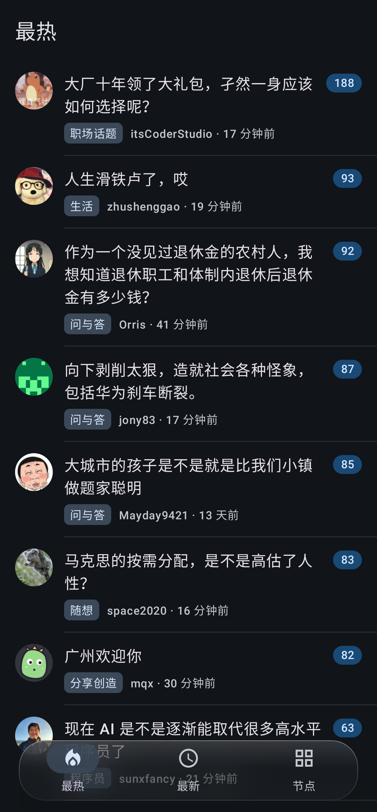
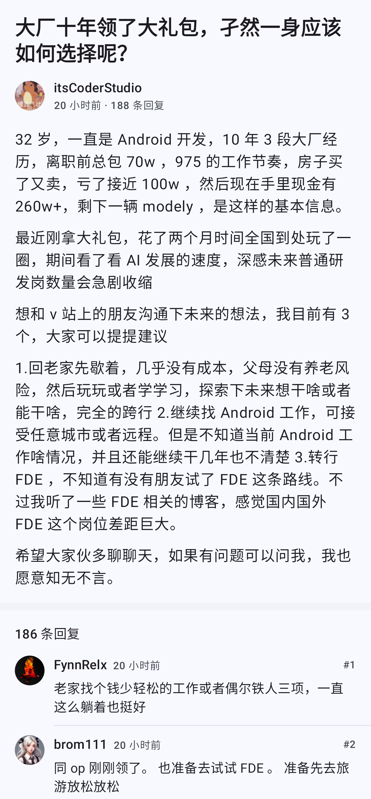

# V2 阅读

[](https://github.com/Chenfyuan/v2ex-android/actions/workflows/android.yml)

非官方 [V2EX](https://www.v2ex.com) Android 客户端。只读浏览主题、节点、用户和提醒，界面是 Material 3，带动态取色、深色模式和悬浮液态玻璃底栏。

> 本项目与 V2EX 官方无关。数据全部来自 V2EX 公开接口，不抓网页登录，也不模拟发帖。

## 功能

- **最热 / 最新 / 节点 / 收藏**：悬浮液态玻璃底栏（选中胶囊包住图标+文字，可按住拖动切换）；可在设置里调整顺序、默认标签，并把收藏放到底栏
- **主题详情**：原生排版；只看楼主；跳楼；`@你` 高亮；**记住阅读位置**（再次打开回到上次楼层）
- **收藏与历史**：本地收藏主题 / 节点，浏览历史；JSON 备份导入导出
- **屏蔽**：屏蔽用户或节点后，列表里不再显示
- **搜索**：本地节点 / 收藏 / 历史 / 主题 ID；全站搜索请跳转浏览器（官方无搜索 API）
- **提醒**：令牌后可读提醒、全部已读；铃铛角标
- **阅读设置**：字号 / 行距 / 字重
- **网页增强翻页**（默认开，可在设置关闭）：「最新」与未填令牌的节点通过只读解析公开网页 `/recent?p=N`、`/go/{节点}?p=N` 无限下滑；解析失败自动回退官方接口
- **离线缓存**：已打开的主题正文和回复缓存约 7 天，弱网优先用缓存
- **限流提示**：中文说明剩余次数与大约恢复时间，可点重试
- **预测性返回**：Android 14+ 边缘滑动预览上一页
- **深链接**与分享；列表缩略图；开屏与应用图标

## 截图

| 首页（浅色） | 首页（深色） | 主题 |
| --- | --- | --- |
|  |  |  |

## 下载

到 [Releases](https://github.com/Chenfyuan/v2ex-android/releases) 下载最新签名 APK。

最低 Android 8.0（API 26），目标 Android 16（API 37）。

## 个人访问令牌（可选）

1. 打开 [v2ex.com/settings/tokens](https://www.v2ex.com/settings/tokens)
2. 创建令牌，粘贴到 App「设置」

令牌只保存在本机。

## V2EX API 说明

| 能力 | 是否需要令牌 |
| --- | --- |
| 最热 / 最新 / 节点 / 主题 / 回复 / 用户 | 否 |
| 节点主题翻页、提醒 | 是 |

- 限流：每 IP 约 **600** 次 / 小时
- **没有**官方全文搜索、发帖、回复、感谢、账号收藏、密码登录。本机收藏 / 屏蔽 / 历史不经过服务器。

## 网页增强翻页的风险

官方 JSON 接口的「最新」「最热」不能翻页，因此本 App 默认读取公开网页列表（不登录、不带 Cookie、请求间隔 ≥1.2 秒并缓存）。
- V2EX 改版可能导致解析失败，此时自动回退官方接口
- V2EX 未公开支持第三方读取网页；如被限制，请在设置关闭「网页增强翻页」
- 「最热」仍只有官方的一页

## 构建与发布

```bash
./gradlew testDebugUnitTest      # 单元测试 + Roborazzi 截图（JDK 21）
./gradlew assembleDebug
# 正式包：签名配置只在本地，不进仓库、不进 GitHub Secrets
V2EX_SIGNING_PROPERTIES=/path/to/signing.properties ./gradlew assembleRelease bundleRelease
```

- **CI**：`.github/workflows/android.yml`，在 push / PR 到 master 时运行（ubuntu-24.04，JDK 21，Gradle 缓存）：lint（不阻断）→ 单元与截图测试 → assembleDebug，上传 debug APK、测试报告与截图作为 artifact。CI 不签名、不发 Release。
- **正式发布**：本地用 release 签名构建 R8 混淆 + 资源压缩的 APK/AAB，手动创建 GitHub Release 并上传。
- 截图测试中 Robolectric 不支持 AGSL，底栏走降级外观（与 Android 12 以下一致）。

## 已知限制

- 未填令牌时节点主题最多约 10 条
- 官方无搜索 API
- 「全部已读」为逐条删除提醒
- 液态玻璃底栏基于 [Kyant0/AndroidLiquidGlass](https://github.com/Kyant0/AndroidLiquidGlass)（backdrop，Apache-2.0）：模糊需 Android 12+，透镜折射/高光需 Android 13+；更旧系统退化为半透明实色底栏，功能不变
- 数据库升级使用破坏性迁移（清除本地收藏 / 历史以外的新表时请留意版本变更说明）

## 技术栈

Kotlin · Jetpack Compose · Material 3 · Room · Coil · jsoup · Kyant backdrop · SplashScreen

## 许可

[MIT](LICENSE)
